<h1>Splunk Data Ingestion, Parsing & SPL Analysis</h1>

<h2>Description</h2>

This phase documents the ingestion, parsing, and analysis of 1,500 simulated Windows security events using Splunk Enterprise. The goal of this phase was to understand how raw log data is processed into searchable security events and develop practical experience using Splunk Processing Language (SPL) to investigate suspicious activity, analyze authentication patterns, and correlate security events.

 In this phase, the following topics were covered:
- <b>Log ingestion and validation</b>
- <b>Raw event data</b>
- <b>Data parsing and timestamp configuration</b>
- <b>Field extraction and search-time fields</b>
- <b>Indexes and sourcetypes</b>
- <b>SPL queries and search filtering</b>
- <b>Statistical analysis</b>
- <b>Tables and visualizations</b>
- <b>Time-based security analysis</b>
- <b>Failed login and brute-force investigation</b>
- <b>Suspicious authentication activity</b>
- <b>Privileged access and account creation analysis</b>
- <b>Security event correlation</b>
- <b>Final dataset validation</b>

This phase established the practical Splunk analysis skills required to investigate suspicious authentication activity, identify potential security threats, and develop detection rules in later phases.
 

<h2>Languages and Utilities Used</h2>

- <b>Splunk Enterprise 10.6.1.1</b>
- <b>Splunk Processing Language (SPL)</b>
- <b>Simulated Windows Security Event Dataset (1,500 Events)</b>
- <b>Web Browser</b>

<h2>Environments Used</h2>

- <b>Host Operating System: Windows 11</b>
- <b>Virtualization Platform: Oracle VirtualBox</b>
- <b>Splunk SIEM Server: Ubuntu Server 24.04.5 LTS</b>
- <b>Splunk Index: windows_security</b>
- <b>Splunk Sourcetype: phase2_windows_security</b>

<h2>Program walk-through:</h2>

<b>Step 1 – Ingest and Examine Log Data</b>  
Imported a dataset containing 1,500 simulated Windows security events into Splunk Enterprise using the Add Data interface. Configured the custom sourcetype phase2_windows_security, reviewed event boundaries and timestamp extraction, and selected the windows_security index. Assigned the constant Splunk host metadata value phase2-dataset to identify the uploaded dataset. The original Windows computer names remained available within the raw events as host fields. Verified successful ingestion by running an SPL search that returned all 1,500 events: 
<a href="https://raw.githubusercontent.com/royalexvo/Splunk-SIEM-Detection-SOAR-Automation-Phase-2/main/Step1.png">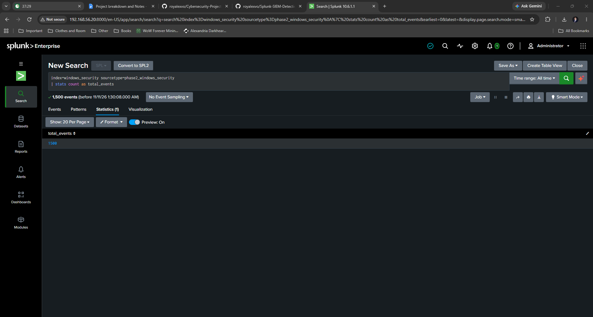</a>

<b>Step 2 – Examine Raw Security Events</b>  
Used Splunk Search & Reporting to examine the ingested Windows security dataset. Reviewed individual raw events containing timestamps, Windows computer names, event IDs, usernames, authentication actions, status values, source IP addresses, and additional event details. Confirmed that Splunk correctly separated the log records into searchable events: 
<a href="https://raw.githubusercontent.com/royalexvo/Splunk-SIEM-Detection-SOAR-Automation-Phase-2/main/Step2.png">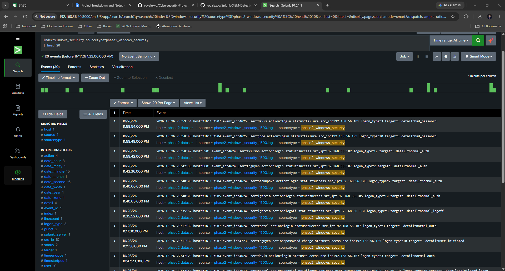</a>

<b>Step 3 – Examine Extracted Fields</b>  
Examined the fields extracted from the simulated Windows security events, including event_id, user, action, status, src_ip, and logon_type. Distinguished between Splunk metadata fields and values contained within the original log records. The Splunk host metadata identified the uploaded dataset as phase2-dataset, while the raw event host field contained the simulated Windows computer name. Used SPL to organize extracted information into a structured table for easier analysis: 
<a href="https://raw.githubusercontent.com/royalexvo/Splunk-SIEM-Detection-SOAR-Automation-Phase-2/main/Step3.png">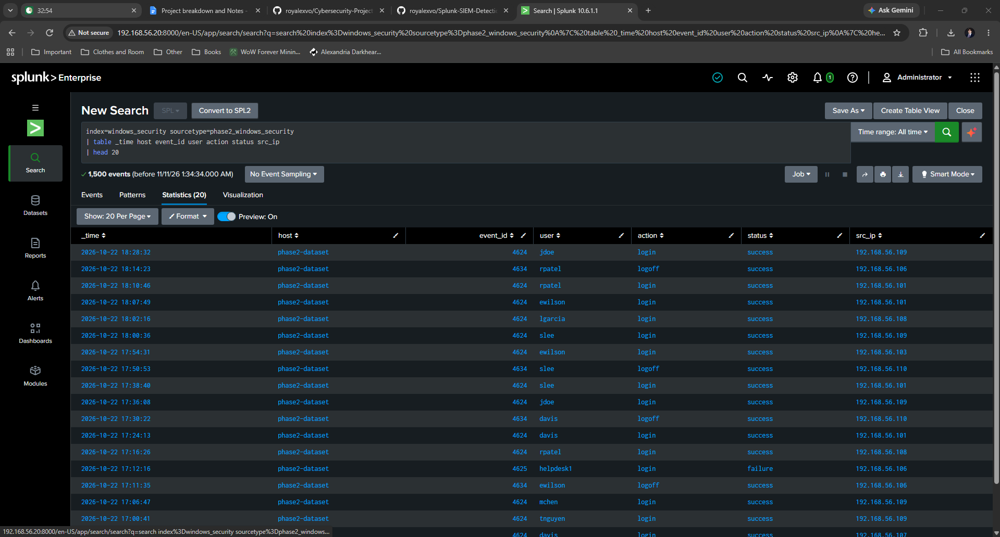</a>

<b>Step 4 – Filter Windows Security Events</b>  
Used SPL search filters to identify Windows Security Event ID 4625, representing failed authentication attempts. Displayed relevant fields such as timestamps, usernames, authentication actions, status values, and source IP addresses. Confirmed that the dataset contained 364 failed login events and demonstrated how event filtering helps narrow large datasets to security-relevant activity: 
<a href="https://raw.githubusercontent.com/royalexvo/Splunk-SIEM-Detection-SOAR-Automation-Phase-2/main/Step4.png">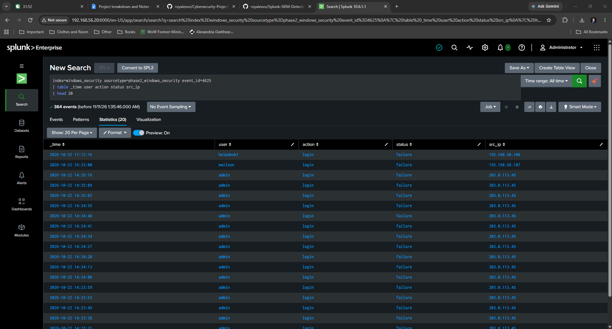</a>

<b>Step 5 – Analyze Failed Logins by Source IP</b>  
Used the SPL stats and sort commands to count failed authentication attempts by source IP address. Identified 203.0.113.45 with 89 failed logins and 198.51.100.77 with 75 failed logins. Compared these results against other source IP addresses to identify unusually high authentication failure counts that could indicate password guessing or brute-force activity within the simulated dataset: 
<a href="https://raw.githubusercontent.com/royalexvo/Splunk-SIEM-Detection-SOAR-Automation-Phase-2/main/Step5.png">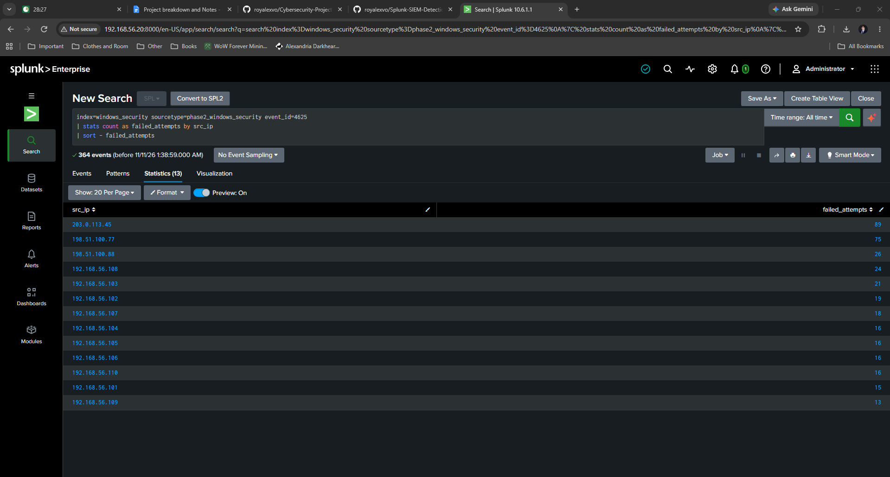</a>

<b>Step 6 – Analyze Failed Logins by User</b>  
Grouped failed authentication events by username using SPL statistical commands. Identified the admin account with 94 failed login attempts and helpdesk1 with 51 failed attempts. Compared authentication failures across user accounts to identify potentially targeted credentials and determine which accounts warranted additional investigation: 
<a href="https://raw.githubusercontent.com/royalexvo/Splunk-SIEM-Detection-SOAR-Automation-Phase-2/main/Step6.png">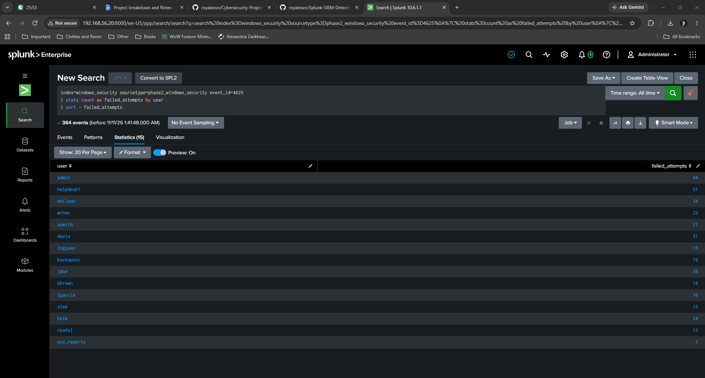</a>

<b>Step 7 – Analyze Failed Logins Over Time</b>  
Used the SPL timechart command with 15-minute intervals to visualize failed authentication attempts over time. Identified a significant spike of 89 failed login attempts on October 22, 2026, at approximately 2:15 PM. Examined the distribution of authentication failures to distinguish concentrated suspicious activity from routine authentication events: 
<a href="https://raw.githubusercontent.com/royalexvo/Splunk-SIEM-Detection-SOAR-Automation-Phase-2/main/Step7.png">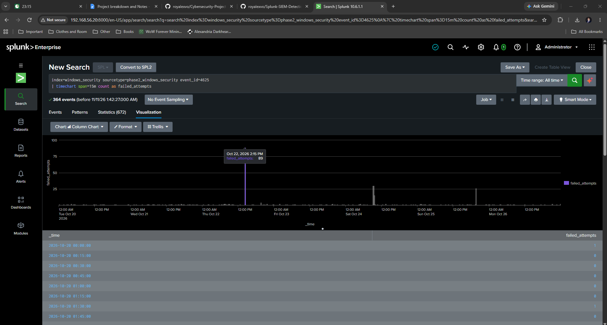</a>

<b>Step 8 – Visualize Authentication Activity by User</b>  
Created a time-based line chart using SPL to compare failed login activity across multiple user accounts. Used the timechart command to group authentication failures by username and identify unusual patterns. Observed a concentrated spike of 89 failed login attempts against the admin account on October 22, 2026, demonstrating how visualizations can highlight suspicious authentication behavior: 
<a href="https://raw.githubusercontent.com/royalexvo/Splunk-SIEM-Detection-SOAR-Automation-Phase-2/main/Step8.png">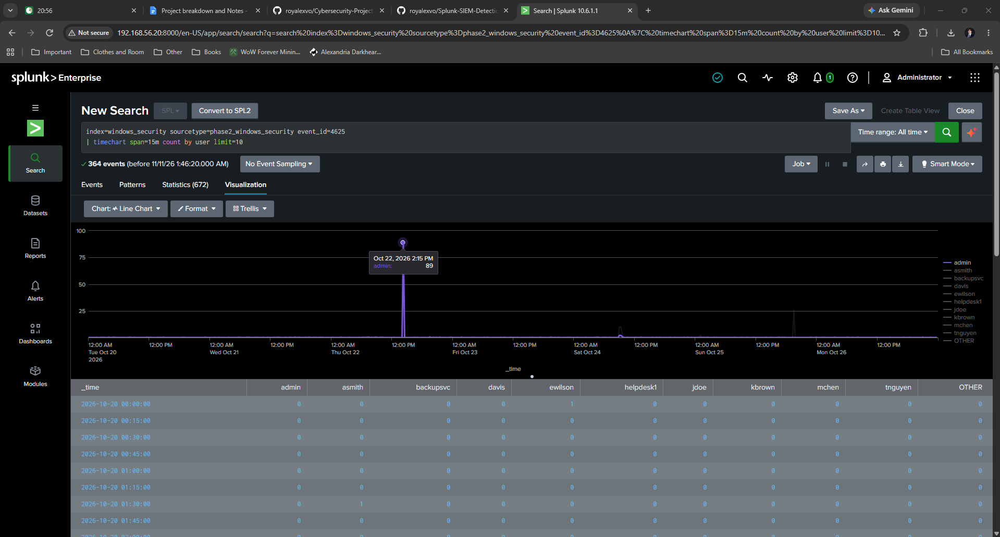</a>

<b>Step 9 – Investigate Suspicious Administrative Logins</b>  
Filtered failed authentication events associated with the admin account and grouped the results by source IP address. Identified 89 failed login attempts originating from 203.0.113.45 and five additional failures from 198.51.100.77. Used these findings to isolate suspicious administrative authentication activity and determine which source addresses required further investigation: 
<a href="https://raw.githubusercontent.com/royalexvo/Splunk-SIEM-Detection-SOAR-Automation-Phase-2/main/Step9.png">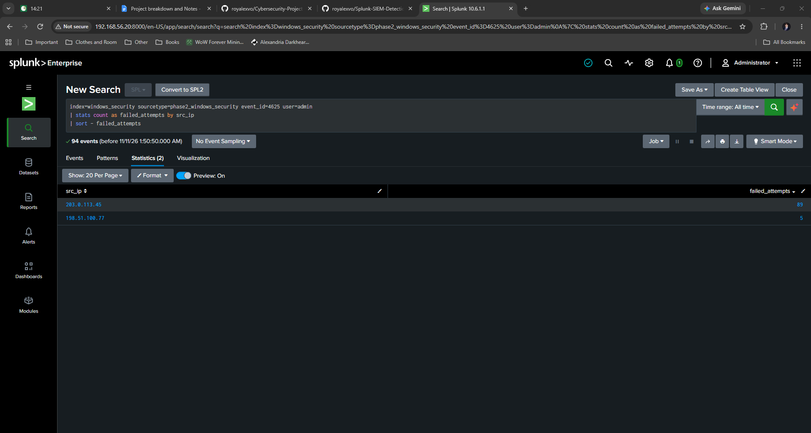</a>

<b>Step 10 – Investigate Failed and Successful Authentication Events</b>  
Correlated Windows Security Event IDs 4625 and 4624 to investigate authentication activity associated with the admin account and source IP address 203.0.113.45. Identified a sequence of repeated failed login attempts followed by a successful authentication event on October 22, 2026. This pattern was consistent with a simulated successful password-guessing attack and demonstrated how correlating event types can reveal suspicious authentication sequences: 
<a href="https://raw.githubusercontent.com/royalexvo/Splunk-SIEM-Detection-SOAR-Automation-Phase-2/main/Step10.png">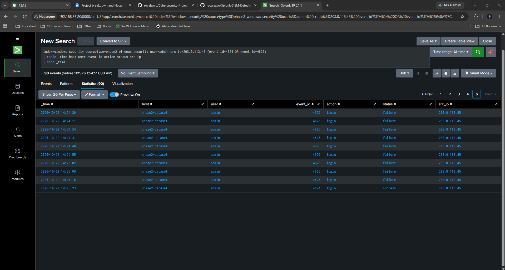</a>

<b>Step 11 – Investigate Privileged Access and Account Creation</b>  
Used SPL to examine Windows Security Event IDs 4672, 4720, 4728, and 4738, focusing on privileged logons, user account creation, group membership changes, and account modifications. Identified simulated activity involving the creation of the svc_audit account and its addition to the Domain_Admins group. Reviewed event timestamps, usernames, source IP addresses, and account targets to investigate potentially unauthorized administrative changes: 
<a href="https://raw.githubusercontent.com/royalexvo/Splunk-SIEM-Detection-SOAR-Automation-Phase-2/main/Step11.png">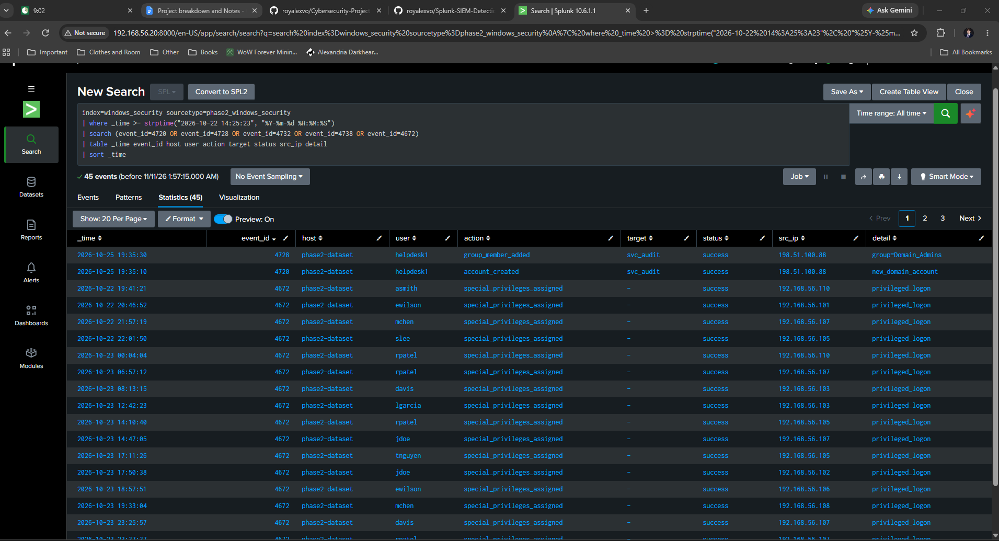</a>

<b>Step 12 – Correlate Suspicious Security Events</b>  
Correlated security events associated with suspicious source IP addresses 203.0.113.45 and 198.51.100.88. Investigated the October 25, 2026 sequence involving repeated failed logins against helpdesk1, a successful authentication event, privileged access, creation of the svc_audit account, and its addition to the Domain_Admins group. Used SPL to organize events chronologically and identify a simulated attack sequence consistent with credential compromise followed by potentially unauthorized administrative activity: 
<a href="https://raw.githubusercontent.com/royalexvo/Splunk-SIEM-Detection-SOAR-Automation-Phase-2/main/Step12.png">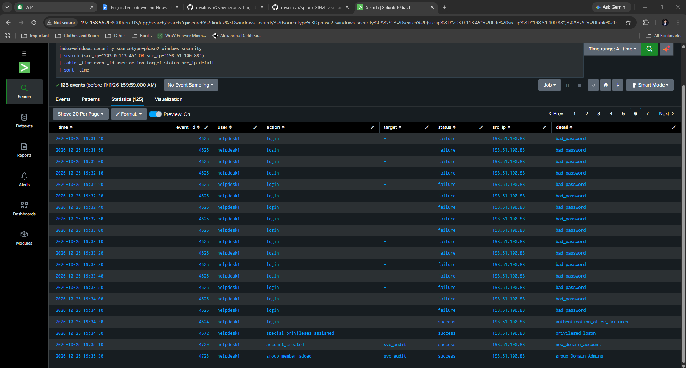</a>

<b>Step 13 – Validate Security Analysis and Complete Phase 2</b>  
Performed a final validation of the 1,500 simulated Windows security events using SPL statistical commands. Confirmed successful ingestion and field extraction by identifying eight unique event IDs, 16 users, 13 source IP addresses, 364 failed logins, 852 successful logins, 60 privileged logons, one account creation event, and one group membership change event. Verified that the dataset was searchable and ready for security detection development in Phase 3: 
<a href="https://raw.githubusercontent.com/royalexvo/Splunk-SIEM-Detection-SOAR-Automation-Phase-2/main/Step13.png">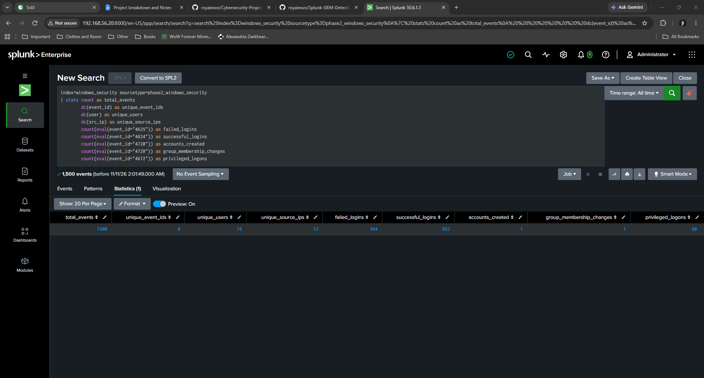</a>

